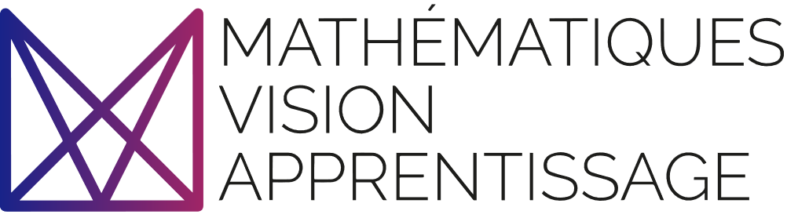
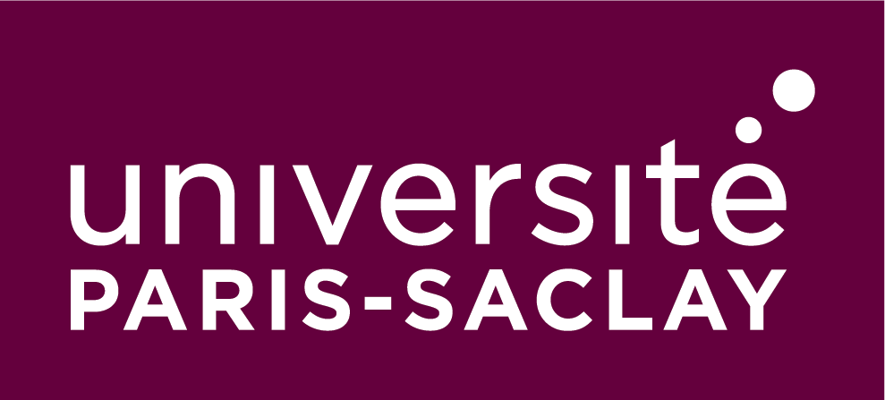

<!-- Bannière moderne violette -->

 

<!-- Liens principaux uniquement -->

  
  &nbsp;
  
  &nbsp;
  

---

## About Me

I am an **MSc MVA** student at **ENS Paris-Saclay** and an engineering graduate from **Institut d'Optique (IOGS)** & **Université Paris-Saclay (MSc ATSI)**. My work sits at the intersection of deep learning, computer vision, and physical systems.

 

  <table>
    <tr>
      <td align="center" width="50%">
        
          
        <strong>MSc MVA</strong> 
        ENS Paris-Saclay — Mathematics, Vision &amp; Learning
      </td>
      <td align="center" width="50%">
        
          
        <strong>IOGS &amp; MSc ATSI</strong> 
        Université Paris-Saclay — Optics, Signal &amp; Image Processing
      </td>
    </tr>
  </table>

---

## Frameworks

  <table>
    <tr>
      <td align="center" width="140">
        
         <b>PyTorch</b>
      </td>
      <td align="center" width="140">
        
         <b>OpenCV</b>
      </td>
      <td align="center" width="140">
        
         <b>CUDA</b>
      </td>
      <td align="center" width="140">
        
         <b>Hugging Face</b>
      </td>
    </tr>
  </table>

---

## Research & Goals

  <table>
    <tr>
      <td valign="top" width="50%">
        <h3>My Research Interests</h3>
        <ul>
          <li><b>Vision Transformers:</b> representation learning, geometric perception, and multimodal architectures.</li>
          <li><b>Robotics &amp; VLA Models:</b> Vision-Language-Action policies bridging 3D perception and physical control.</li>
          <li><b>Vision-Language Models:</b> grounded visual reasoning and temporal understanding.</li>
        </ul>
      </td>
      <td valign="top" width="50%">
        <h3>What I Want to Do Later</h3>
        

          I aim to join an <b>AI research laboratory</b> working on foundation models for <b>vision and language</b>, pushing forward multimodal reasoning and embodied intelligence.
        

        <h3>Recent Experience</h3>
        

          Recent research and engineering internships (including <b>ECTA</b> / <b>UQTR</b> and <b>Aurea Technology</b>) focused on 3D imaging, deep learning reconstruction, and optical systems.
        

      </td>
    </tr>
  </table>

